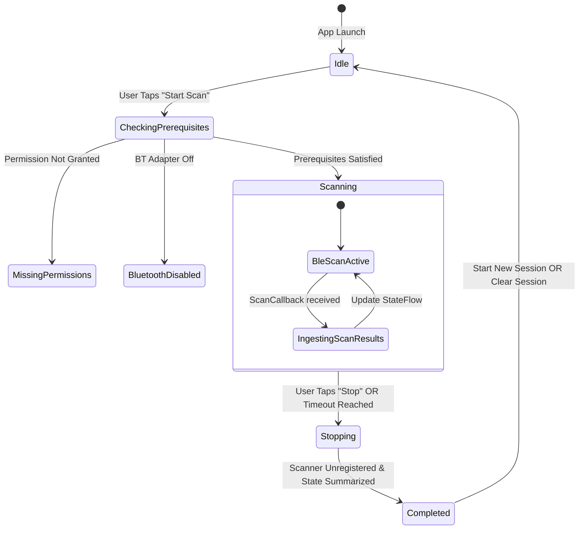

# Architecture Document — RideAware

**Application Package:** `com.rideaware`  
**Architecture Pattern:** Clean Architecture + MVVM + Unidirectional Data Flow (UDF)  
**Concurrency Model:** Kotlin Coroutines + StateFlow / SharedFlow  

---

## 1. System Architecture Overview

RideAware adheres to official Android architectural best practices with clear separation between the UI layer, ViewModel layer, Domain layer, and Data/Platform layer.

```
                    ┌────────────────────────────────────────┐
                    │            UI Layer (Compose)          │
                    │   Home | Nearby | Report | Safety | Set│
                    └───────────────────▲────────────────────┘
                                        │ Observes StateFlow<UiState>
                                        │ Dispatches User Actions
                    ┌───────────────────▼────────────────────┐
                    │             ViewModel Layer            │
                    │ ScanViewModel, ReportViewModel, etc.  │
                    └───────────────────▲────────────────────┘
                                        │ Interacts via Domain Use Cases / Repos
                    ┌───────────────────▼────────────────────┐
                    │              Domain Layer              │
                    │ Models, Classifier, RepositoryContract │
                    └───────────────────▲────────────────────┘
                                        │ Implements Contracts
                    ┌───────────────────▼────────────────────┐
                    │           Data & Platform Layer        │
                    │ BleScanner, BluetoothAdapterManager    │
                    └────────────────────────────────────────┘
```

---

## 2. Layer Responsibilities

### 2.1 UI Layer (`ui/`)
- Pure declarative Jetpack Compose components.
- Completely free of direct Android Bluetooth API imports.
- Subscribes to immutable `StateFlow` states emitted by ViewModels.
- Reusable Material 3 design components: `SignalStrengthBadge`, `ObservationCard`, `DeviceDetailsDialog`, `SafetyAlertBanner`, `MetricChip`.

### 2.2 ViewModel Layer (`ui/viewmodel/`)
- Manages screen presentation logic and UI state machines.
- Coordinates Coroutine scopes bound to `viewModelScope`.
- Handles scan timer countdowns and UI state mapping (`Idle`, `Scanning`, `Disabled`, `Error`, `Completed`).
- Zero direct references to `Activity` instances, preventing memory leaks.

### 2.3 Domain Layer (`domain/`)
- Pure Kotlin business logic with no Android platform dependencies where possible.
- **Models:** `DiscoveredDevice`, `ScanSession`, `DeviceCategory`, `SignalCategory`, `ScanStatistics`.
- **Classification Engine:** `DeviceClassifier` inspects advertised Service UUIDs (e.g., A2DP Sink/Source, Audio Sink `0x110B`, BLE Audio `0x184E`) or advertised names to categorize as `POSSIBLE_AUDIO_INDICATOR`, `OTHER_KNOWN_CATEGORY`, or `UNKNOWN`.
- **Repository Interface:** `ScanRepository` contract defining data streams.

### 2.4 Data & Platform Layer (`data/` & `permissions/`)
- Direct integration with native Android `BluetoothManager`, `BluetoothAdapter`, and `BluetoothLeScanner`.
- Safe callback handling inside `AndroidBleScanner`:
  - Dispatches results onto background coroutine contexts (`Dispatchers.Default`).
  - Session-level MAC address obfuscation (`DEV-` + SHA-256 slice) to ensure privacy.
  - Safe unregistering of `ScanCallback` upon scan timeout or user cancellation.
- Permission manager (`PermissionHandler`) handling Android 12+ (`BLUETOOTH_SCAN`, `BLUETOOTH_CONNECT`) vs pre-Android 12 (`ACCESS_FINE_LOCATION`).

---

## 3. Package & Directory Structure

```text
app/
├── src/
│   ├── main/
│   │   ├── AndroidManifest.xml
│   │   ├── java/com/rideaware/
│   │   │   ├── RideAwareApplication.kt
│   │   │   ├── MainActivity.kt
│   │   │   ├── navigation/
│   │   │   │   └── AppNavigation.kt
│   │   │   ├── ui/
│   │   │   │   ├── theme/
│   │   │   │   │   ├── Color.kt
│   │   │   │   │   ├── Theme.kt
│   │   │   │   │   └── Type.kt
│   │   │   │   ├── components/
│   │   │   │   │   ├── CommonCards.kt
│   │   │   │   │   ├── SignalBadge.kt
│   │   │   │   │   └── StateBanners.kt
│   │   │   │   ├── screens/
│   │   │   │   │   ├── HomeScreen.kt
│   │   │   │   │   ├── NearbyDevicesScreen.kt
│   │   │   │   │   ├── ScanReportScreen.kt
│   │   │   │   │   ├── SafetyScreen.kt
│   │   │   │   │   └── SettingsScreen.kt
│   │   │   │   └── viewmodel/
│   │   │   │       ├── ScanViewModel.kt
│   │   │   │       └── ScanUiState.kt
│   │   │   ├── domain/
│   │   │   │   ├── model/
│   │   │   │   │   ├── DiscoveredDevice.kt
│   │   │   │   │   ├── DeviceCategory.kt
│   │   │   │   │   ├── SignalStrength.kt
│   │   │   │   │   └── ScanReportData.kt
│   │   │   │   ├── classifier/
│   │   │   │   │   └── DeviceClassifier.kt
│   │   │   │   └── repository/
│   │   │   │       └── ScanRepository.kt
│   │   │   ├── data/
│   │   │   │   ├── bluetooth/
│   │   │   │   │   ├── AndroidBleScanner.kt
│   │   │   │   │   └── BleScannerInterface.kt
│   │   │   │   └── repository/
│   │   │   │       └── ScanRepositoryImpl.kt
│   │   │   ├── permissions/
│   │   │   │   └── PermissionHelper.kt
│   │   │   └── util/
│   │   │       └── TimeFormatter.kt
│   │   └── res/
│   └── test/
│       └── java/com/rideaware/
│           ├── DeviceClassifierTest.kt
│           ├── SignalStrengthTest.kt
│           ├── ObservationDeduplicationTest.kt
│           └── ScanStatisticsTest.kt
├── build.gradle.kts
└── ...
```

---

## 4. State Flow & Scan Lifecycle



---

## 5. Threading & Concurrency

- **Bluetooth Le Callbacks:** Run on platform binder thread; immediately forwarded to Coroutine channel/flow on `Dispatchers.Default`.
- **UI State Collection:** `collectAsStateWithLifecycle()` ensures zero wasted recompositions when the application is backgrounded.
- **Scan Timer:** Launched as a structured child coroutine inside `viewModelScope`, cancelled automatically if scan is stopped manually.
